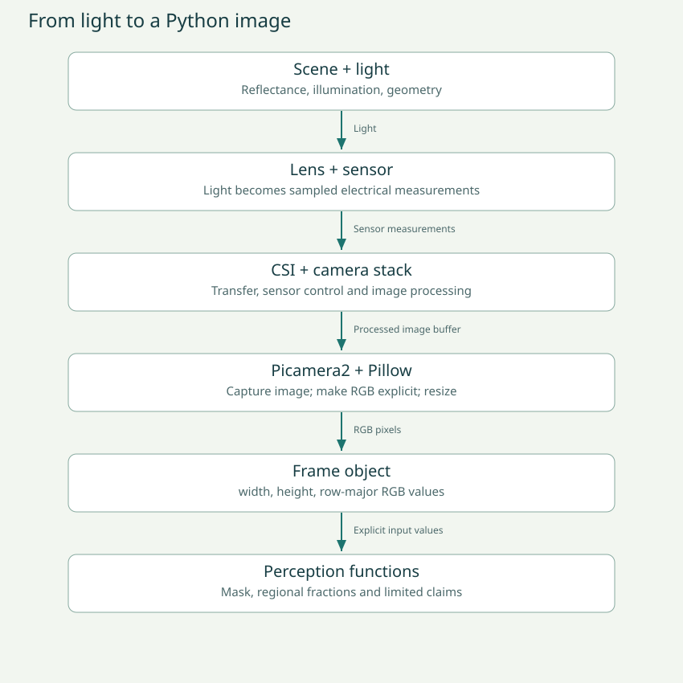
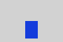

# Session 1 · From light to pixels to evidence

**Duration: 120 minutes, including a five-minute break.** Today PiDog stays stationary. You already made the ultrasonic sensor report distance and checked it with a ruler. Now we will ask what a camera measures, how a picture becomes numbers, and which conclusions those numbers support.

By the end, you will capture your own image, locate an RGB pixel, build and inspect a blue-pixel mask, and explain one case where a correct color detector gives the wrong answer about an obstacle. Keep Quick Start beside this notebook.

**Notes: Date, student, tutor, Pi model, camera model if known, and the question you want to answer today.**

_Write your answer here._


## 0–10 minutes · Retrieve what sonar taught us

Explain last session without opening your code. What did the ultrasonic sensor send out? What did it receive? Which quantity did the software turn into centimeters? What did the ruler contribute that the sensor could not provide by itself?

The ruler gave an independent measurement for comparison. A camera experiment also needs independent truth: we place an object, record its color and distance, and inspect what is actually there before reading our algorithm's output.

| Measurement | Ultrasonic sensor | Camera |
| --- | --- | --- |
| Physical signal | Emitted sound and returning echo | Light arriving through a lens |
| Typical software representation | Range estimate in centimeters | A grid of pixel values |
| Spatial coverage | A beam with a finite spread | A two-dimensional field of view |
| Important ambiguity | Echo may come from a different surface than expected | Many different 3D scenes can produce similar 2D images |
| Independent truth today | Ruler and known object placement | Known object placement, ruler, and human inspection |

A camera does not directly give centimeters. A sonar reading does not directly say “box.” Both need interpretation. More sensors give different evidence, but we still have to decide how to use it.

**Notes: Sketch or describe the sonar measurement chain. Then predict what extra information the camera gives and what information it does NOT directly give.**

_Write your answer here._


## 10–25 minutes · Trace the image through the system

Light reflects from the scene, passes through the lens, and reaches a light-sensitive sensor. The sensor converts incoming light into electrical measurements. In a typical Bayer color sensor, different sites have different color filters; a raw sample is not already a complete red-green-blue triple at every location. Image processing estimates missing color components and adjusts the image. This includes demosaicing, white balance, and other processing. The result we use is an RGB image in memory.

The camera ribbon carries image information through the Raspberry Pi's CSI interface. The Pi's camera stack manages the sensor and image processing. Picamera2 exposes Python methods for configuring and capturing frames. Our small camera wrapper converts the returned image to an explicit RGB representation. The perception functions then operate on those values. The HAT controls other robot functions, but the camera ribbon goes to the Pi; do not draw the camera image as traveling through the servo PWM controller.



**Definition — exposure:** the time over which the sensor collects light for a frame. Longer exposure can brighten a dark image, but moving objects can blur. **Gain** amplifies the signal and can make noise more visible. **White balance** adjusts relative color-channel gains so colors look more consistent under different illumination. These automatic processes can change pixel values even when the object itself has not changed.

**Definition — frame:** one image at one time. **Frame rate:** how many frames are produced per second. **Latency:** how old the information is by the time a decision uses it. A fast frame rate does not guarantee a fresh decision if frames wait in a queue.

Our capture program waits two seconds for startup, requests one frame, resizes it, and closes the camera. The two seconds are a practical starting point, not a guarantee that exposure has stabilized. Its recorded timestamp is receipt time, not the sensor's exposure time. We will analyze saved images offline; these are not suitable as live movement commands.

**Notes: Draw six boxes: scene, lens/sensor, CSI, Pi camera stack, Python image, perception result. Label every arrow with what travels across it. Circle the hardware/software boundary.**

_Write your answer here._


**Notes: Define exposure, gain, white balance, frame rate, and latency in your own words. Give one experiment that changes only one of these or observes its effect.**

_Write your answer here._


## 25–40 minutes · Check the camera and capture a frame

Follow Quick Start first. Stop any existing preview or tracking program: only one program should own the camera at a time. Place the robot securely on a clear floor with its current head orientation; do not force powered joints by hand. Our programs do not construct a PiDog object or issue servo commands. Stop any background app that might move it.

Run all commands from the extracted camera-lab folder. On the Pi, first inspect your interpreter and installed packages:

```sh
python3 -m camera_lab.doctor
```

Read the output together. A module is a Python file or package we can import. A successful import means Python found the package; it does not prove the camera can take a picture. If Picamera2 is missing, follow the conditional setup in Quick Start. Do not reinstall the whole working robot environment.

Put blue paper or a blue-covered box in front of the camera, with neutral surroundings. Add a red object to help catch red/blue channel mistakes. Capture once:

```sh
python3 -m camera_lab.capture --out captures/blue-center-01
```

The folder must be new. This is deliberate: evidence from an earlier trial should not silently disappear. You should get frame.json and frame.svg. Copy the folder to your laptop as described in Quick Start, then open frame.svg in a browser. The actual camera result may differ from our synthetic example. Record what is visible rather than assuming the capture succeeded correctly.



Find the following in camera_lab/capture.py: constructing CameraSource, creating a configuration, starting the camera, capturing an image, converting to RGB, resizing, and closing in finally. Explain why the device is closed even when capture raises an error. The wrapper owns the camera; pure perception functions do not.

**Notes: Save the command, output folder, observed image orientation, and any error. Is the blue object blue in the image? Which way does the image move when you move the object to the robot's left?**

_Write your answer here._


## 40–55 minutes · A picture is a structured set of numbers

**Pixel:** one sample location in an image. In this lesson, each pixel holds three integers: R, G, B. Each channel ranges from 0 to 255. This is an encoding of processed color intensity, not a direct measurement of meters, object identity, or certainty.

| RGB example | Expected appearance | Question |
| --- | --- | --- |
| (255, 0, 0) | Red | Which channel is strongest? |
| (0, 0, 255) | Blue | What happens if R and B are swapped? |
| (0, 0, 0) | Black | Is this empty space or could it be a dark object? |
| (255, 255, 255) | White | Why are all three channels high? |
| (100, 100, 100) | Gray | What distinguishes gray from a saturated color? |

Image coordinates start at the top left: x increases to the right, y increases downward. For width W and height H, x ranges from 0 to W−1 and y from 0 to H−1. Our Frame stores rows consecutively in a flat list. The index is y × W + x. The first pixel is index 0.

For a 4×3 image, pixel (2,1) is at index 1×4+2 = 6. There are 12 pixels and 36 channel values. A 160×120 RGB image contains 19,200 pixels and 57,600 channel values. That is 57,600 bytes for tightly packed 8-bit RGB, but our educational JSON file is much larger because it stores text punctuation and numbers. A Python list also has overhead.

Try the interactive image bench below, then use the terminal to inspect an actual pixel. Run python3 to enter the Python prompt; type these lines, then exit().

```python
from camera_lab.files import load_frame
frame, metadata = load_frame('captures/blue-center-01/frame.json')
print(frame.width, frame.height)
print(frame.pixel(80, 60))
print(frame.pixel(0, 0))
```

Exercise 1: open exercises/student.py and implement flat_index. Explain where your formula comes from before writing the function. In the Python prompt, test flat_index(2,1,4). These functions assume the coordinate preconditions written in their docstrings; Frame.pixel adds bounds validation.

**Notes: Predict the index of (3,2) in a width-4 image. Explain the difference between a pixel, a channel, resolution, file size, and object size. Record two real RGB samples with their coordinates.**

_Write your answer here._


## 55–60 minutes · Break and preserve work

Export this notebook as JSON now. Keep your capture filenames in your notes. If you switch computers, restore the JSON in this same session workbook. The notes are saved locally when your browser permits it; they are not automatically shared with your tutor.

## 60–80 minutes · Turn a color idea into a mask

A human can say “that blue bit.” A program needs an explicit rule. Checking B > R alone would include many colors and does not handle all lighting changes. We use HSV, a different representation of the same RGB information:

- Hue describes color position around a color wheel.
- Saturation describes how far the color is from gray.
- Value is the maximum RGB channel after normalization, a simple brightness-related quantity rather than physical luminance.

Python's colorsys functions use fractions from 0 to 1 for all three. Blue has hue around 2/3. In OpenCV's common 8-bit HSV representation, the numerical ranges differ: do not paste its thresholds directly into this code. RGB-to-HSV conversion reorganizes the information; it does not recognize objects or learn from examples.

Our blue rule accepts hue from .52 to .72, saturation at least .40, and value at least .20. These are starting values for an experiment, not universal blue boundaries. Read is_blue in camera_lab/core.py. The return value is a Boolean: True for a matching pixel, False otherwise.

**Mask:** one Boolean or binary value per image location. In the displayed mask, white means the pixel passed the rule. Black means it did not. White does not mean the image is bright, and black does not mean an obstacle is absent.

Run the supplied fixture first so everyone can reproduce the same result:

```sh
python3 -m camera_lab.analyze data/blue-center.json --out results/fixture-blue-01
```

Open results/fixture-blue-01/image.svg and mask.svg. The blue patch should become white in the mask. The report's center blue_ratio is 0.5 and center status is marker_present. It is the ratio within the lower-center region, not half of the whole picture.

Then run your real image:

```sh
python3 -m camera_lab.analyze captures/blue-center-01/frame.json --out results/real-blue-01
```

**Notes: Before opening the mask, sketch which parts you expect to turn white. Which unexpected pixels matched? Which real blue pixels were missed? Explain what each of H, S and V contributes to the rule.**

_Write your answer here._


## 80–100 minutes · Regions, fractions, and controlled tests

**Region of interest (ROI):** the subset of an image chosen for a measurement. We split the lower half into left, center and right image regions. They are image regions, not calibrated safe travel corridors. Their physical coverage depends on camera orientation, perspective and distance.

A box is represented as [x0,y0,x1,y1), with upper bounds excluded. Its area is (x1−x0)×(y1−y0). A region's blue fraction is matching pixels divided by all pixels in that region. Our synthetic fixture is 90×60; its lower-center region is 30×30 = 900 pixels, with 18×25 = 450 blue pixels. Thus its blue fraction is 450/900 = 0.5.

The area threshold .08 means at least 8% matching pixels. It is not 8% confidence that an obstacle exists. We also check mean value: a region below .12 becomes unknown. This is a limited darkness check; it does not detect every bad frame, occlusion, glare, blur or camera failure.

Exercise 2: implement marker_fraction. Return count/area after checking the documented constraints. What should happen if area is zero? Raise ValueError rather than inventing a fraction.

Choose three measured positions, for example 20, 40 and 60 cm, as starting distances that fit your actual setup. Move the same box along the camera's viewing direction while keeping light, orientation and camera pose as similar as possible. Capture a new folder for each. Analyze each. Use data/measurements.csv for results.

At each position record measured distance, apparent pixel width, center fraction, and whether the box is fully visible. A nearer object often appears larger, but size also depends on real dimensions, pose, clipping, lens and processing. Do not convert width into centimeters without a geometric model and calibration.

**Notes: Prediction, three ruler distances, three filenames, apparent widths, fractions, and result. Which variables stayed fixed? Can two different-size objects have the same pixel width?**

_Write your answer here._


For a quick failure test, change only the object's color by replacing blue paper with red. Use the provided red-center fixture if time is short:

```sh
python3 -m camera_lab.analyze data/red-center.json --out results/red-01
python3 -m camera_lab.analyze data/dark.json --out results/dark-01
```

The red object produces marker_absent; the dark image produces unknown. Neither grants permission to move. The software prints an evidence message and never sends a movement command.

**Notes: A red box is physically present but our detector says marker_absent. Is this a bug in the color rule, a wrong choice of task, or both? Explain the exact claim the output supports.**

_Write your answer here._


## 100–115 minutes · Code review and evidence

Trace one pixel through Frame.pixel, rgb_to_hsv, is_blue and blue_mask. Then trace a group of pixels through region_report. Write inputs, outputs, units and side effects for each. A pure function transforms input values without opening devices or writing files; save_frame and CameraSource.capture intentionally perform side effects.

Run the reference checks from the project root:

```sh
python3 -m unittest discover -s tests -v
python3 check_exercises.py --student
```

The supplied software tests should pass on a laptop without camera packages. The student checker will still report unfinished exercises 3 and 4; this is expected. Distinguish “not implemented yet” from a wrong answer in a function you completed. Ask AI for one failing input or one hint, not a replacement project.

**Notes: Pick one function. State its purpose, input types and units, return value, side effects, invalid-input behavior, and a concrete example. Paste one test result and explain why it passed or failed.**

_Write your answer here._


## 115–120 minutes · Teach back and save

Explain the whole pipeline without reading: light → image → numbers → mask → fraction → a limited claim. Show the tutor one real image, its mask, your measurement table and your strongest counterexample.

- [ ] I can locate a pixel and explain RGB and HSV units.
- [ ] I captured and inspected a real frame, or recorded the exact hardware blocker and completed the fixture route.
- [ ] I can explain why marker_absent does not mean a clear path.
**Notes: What can I explain independently now? What should we test in session 2? Save your best evidence filenames and export your notes.**

_Write your answer here._

