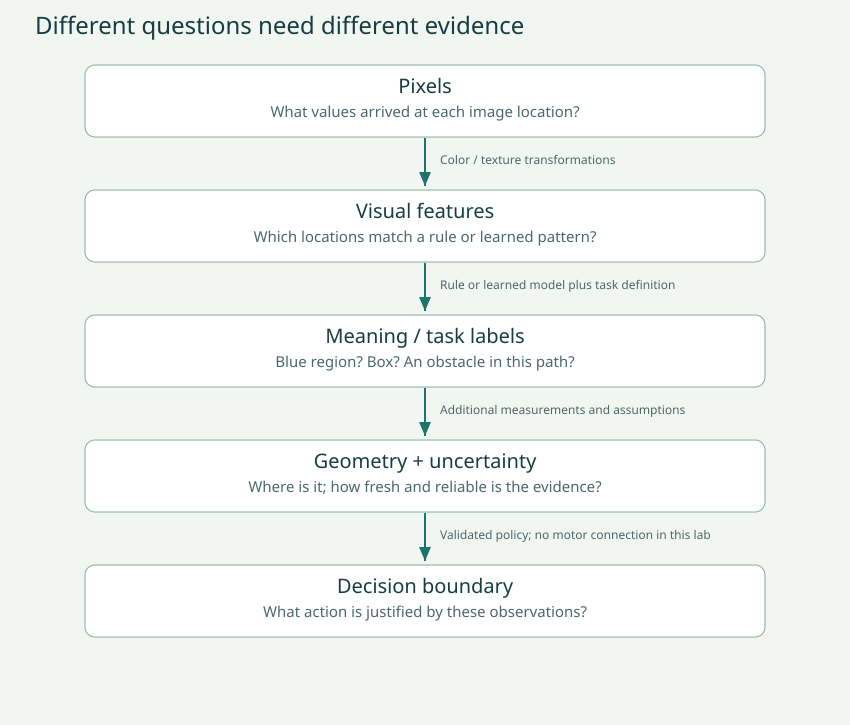
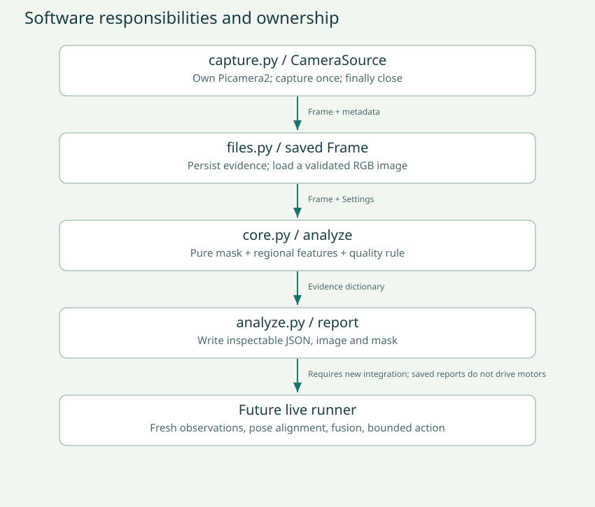

# Session 2 · From visual evidence to semantics and a pipeline

**Duration: 120 minutes, including a five-minute break.** Bring session 1's image, mask, measurements and counterexample. Today you will build a regional detector, test its limitations, learn what supervised learning changes, and design the camera interface for the obstacle project.

The core outcome is a camera perception pipeline you understand and can test. It reports evidence; it does not yet drive PiDog. A rule that finds a marker is useful, but it is not a complete navigator.

**Notes: Date, your strongest result from session 1, and one unresolved question.**

_Write your answer here._


## 0–10 minutes · Retrieval challenge

Without opening the glossary, define pixel, channel, ROI, mask, threshold, exposure and latency. Draw the camera pipeline from memory. Explain why a perfectly accurate blue detector can miss an obstacle. Now open your earlier diagram and make corrections in a different color or list the revisions below.

**Notes: My pipeline from memory; what I corrected; one important distinction between an image coordinate and a distance in the world.**

_Write your answer here._


## 10–25 minutes · What do we mean by understanding an image?

**Semantics** concerns meaning: what a visible region represents, how entities relate, and what those interpretations imply for a task. We can break a broad claim like “the robot understands the room” into smaller, testable outputs.

| Task | Example input/output | What it does not establish |
| --- | --- | --- |
| Color segmentation | RGB image → mask of blue pixels | Whether those pixels belong to a box, wall or painted floor |
| Image classification | Whole image → box-present label | Which pixels belong to the box or where it is |
| Object detection | Image → labels and bounding boxes | Accurate depth or every obstacle outside known classes |
| Semantic segmentation | Image → class label per pixel | Unique identities for separate objects of the same class |
| Instance segmentation | Image → separate masks for each object | Whether the robot can pass between them |
| Depth estimation | Image(s) → estimates of scene depth | Perfect metric distances or safe movement |
| Tracking | Frames → correspondences or object trajectories | Correct object identity through every occlusion |
| Navigation | Current evidence and goal → motion decisions | That a single image contains all required information |



The labels we choose define the task. “Blue pixel,” “blue marker,” “box,” and “obstacle in PiDog's swept path” are different labels. A box to the side might not obstruct the current movement. A low object might be dangerous even if a pretrained detector has no name for it. A poster of a box may look like a box without occupying the expected space.

**Model:** a rule or parameterized mapping from inputs to outputs. **Feature:** a measured property supplied to a model, such as blue fraction, edge strength, apparent width or a learned representation. **Representation:** the form in which useful information is encoded. Our mask is a representation; a neural network's intermediate arrays are also representations.

A supervised neural network learns parameters from input/label examples. During training, predictions are compared to labels using a loss; optimization adjusts parameters to reduce training loss. During inference, the learned parameters produce outputs for new inputs. Layers can combine local patterns into more complex representations, but that does not guarantee human-like meaning or correct behavior in a new room. We will actually run a much smaller learned model so every training decision is visible.

**Notes: For each claim—blue region, box, near object, unsafe path—state what evidence we currently have and what additional evidence or model would be needed. Invent a scene that fools each overly broad claim.**

_Write your answer here._


## 25–45 minutes · Build the regional detector

Read analyze in camera_lab/core.py. It creates one mask, then uses the same mask for three lower-image regions. For a 160×120 frame, the x boundaries are 0, 53, 106 and 160; the lower y range is 60 through 119. The last region is one pixel wider. Integer division and explicit boundaries avoid dropping pixels.

The result is a dictionary. Each region has a pixel count, area, fraction, mean value, status, bounding box and centroid. A dictionary groups named results. Frame and Settings are dataclasses: classes that package related values and generate routine initialization. Frame.pixel is a method because it uses the image stored in a particular Frame object. Settings is frozen to discourage changing a configuration halfway through a test.

**Bounding box:** the smallest axis-aligned rectangle enclosing the selected pixels. Our implementation encloses all selected pixels in an ROI, not one separately identified object. Two disconnected blue patches can produce one large box spanning empty space. **Centroid:** average coordinate of the selected pixels; it can lie between disconnected patches. Neither is the object's 3D center.

Look at the yellow ROI outlines and magenta mask bounding boxes in image.svg. The mask image itself stays binary. Move your blue target between image left, center and right, capturing and analyzing three new images. Maintain camera pose and lighting. Predict which region's fraction rises. A target can cross a region boundary, so two regions may both match.

```sh
python3 -m camera_lab.capture --out captures/blue-left-02
python3 -m camera_lab.analyze captures/blue-left-02/frame.json --out results/blue-left-02
```

Repeat with unique center and right folder names. If camera access is unavailable, compare data/blue-left.json, blue-center.json and blue-wall.json. The wall fixture has blue only in the upper part: the full frame reports a marker, while the lower regions do not. This demonstrates how ROI selection changes the task.

Exercise 3: implement marker_status in exercises/student.py. Test dark-but-blue, exactly-on-threshold, and just-below-threshold cases. A dark region must return unknown before a fraction threshold is considered. The preconditions assume ratio and mean value are valid fractions; Settings and Frame validate the production inputs elsewhere.

**Notes: Draw the ROIs, record three filenames and region fractions, and explain the bounding box convention. What happens if two separate blue objects enter one ROI? What would connected-component labeling add?**

_Write your answer here._


## 45–55 minutes · Perturb one variable and diagnose

Choose one experiment below. Use the other as a fast fixture demonstration or extension. For each, write your prediction before looking at the output.

**Lighting test:** photograph the same object and pose in ordinary room light, dimmer light, and with a shadow across it. Keep the ruler distance fixed. Do not shine a powerful light into the sensor. Record mean value, blue fraction and status. The camera's automatic settings may compensate, so record actual output instead of assuming dimmer room light always produces lower values.

**Distractor test:** add blue paper flat on the floor, or put a blue patch on a background surface. Ask whether the selected pixels belong to the obstacle you meant. Keep the real obstacle in place while changing its visible color, then observe whether your detector's answer changes.

This is error analysis. First locate the failed stage: bad capture, wrong color order, poor color rule, wrong ROI, incorrect task label, or a policy that overclaims. Making the threshold more permissive can recover missed blue pixels while also increasing false positives. It cannot recover all non-blue obstacles from a blue-only feature.

**Notes: Experiment question; fixed variables; changed variable; filenames; predicted vs observed result; failed stage; next test.**

_Write your answer here._


## 55–60 minutes · Break and export

Export your notes. Keep your test image list separate from tuning images. If you repeatedly inspect the final test set while choosing thresholds, it is no longer a clean test of unseen conditions.

## 60–80 minutes · Train a tiny model and expose its shortcut

In session 1 we hand-selected .08. Now a program will choose a threshold from labeled training examples. This is a simple supervised learning exercise: the parameter is a single number; the feature is blue area fraction; the target is obstacle presence. It is not deep learning and does not train a general object detector.

A training example combines measured features with a label supplied independently. Training examples fit parameters. Validation examples help assess choices during development. Test examples are held aside for a final evaluation after choices are frozen. Group photographs of the same scene together: adjacent frames of one setup should not be scattered across all three splits.

Open data/TOY-learning.csv. Every row is synthetic and clearly labeled as such. The four training fractions are 0.00, 0.02, 0.20 and 0.35; the first two are labeled no obstacle, the last two obstacle. The code considers midpoint thresholds plus endpoints, counts training errors, and breaks ties by choosing the larger threshold. Fit_threshold receives training rows only.

Predict a threshold separating the training groups. Predict what happens to a red obstacle with blue fraction 0 and a harmless blue floor marking with fraction .30. Then run:

```sh
python3 -m camera_lab.learn data/TOY-learning.csv
```

Record the learned threshold and each split’s accuracy from your run. Inspect the red-obstacle and blue-floor-marking cases: which errors occur, and why? These synthetic results are not measured performance of PiDog.

| Actual / predicted | Predicted obstacle | Predicted no obstacle |
| --- | --- | --- |
| Actual obstacle | True positive (TP) | False negative (FN) |
| Actual no obstacle | False positive (FP) | True negative (TN) |

Accuracy is correct predictions divided by all examples. It can hide important error types, especially with imbalanced classes. Precision asks what fraction of positive predictions were correct; recall asks what fraction of actual positives were found. For collision avoidance, missed obstacles deserve explicit attention; reporting accuracy alone would obscure them. Neither good accuracy nor a neural-network confidence score proves safety.

**Notes: Predict the learned threshold and all four test outputs before running. Then record TP, TN, FP, FN and explain the shortcut learned from the training set. How would you improve the data AND the features?**

_Write your answer here._


Optional real-data extension: use data/real-learning-template.csv and independent human obstacle labels. Plan at least 18 distinct scene groups: six train, six validation, six test, with both classes in each. For each usable image, transfer full.blue_ratio from report.json into the CSV. Keep the object positions, background and lighting varied. Do not enter unknown-quality captures as good measurements. Record exclusions and their reasons. Use the supplied toy set for the scheduled lesson; a credible real dataset takes additional collection time.

If you revise features or labels after viewing test errors, collect a new test set for the next evaluation. Re-running on the same images can demonstrate a fix, but it is not new evidence of generalization.

## 80–100 minutes · Build the software boundary for the robot



| Module | Responsibility | Boundary |
| --- | --- | --- |
| capture.py / CameraSource | Own camera, capture once, normalize RGB, close | Camera library → Frame |
| core.py / Frame and Settings | Represent validated image and parameters | Values with explicit conventions |
| core.py / perception functions | Color mask, region features and statuses | Frame → evidence dictionary |
| analyze.py | Command-line options, call pure functions, save results | Experiment orchestration |
| files.py | Read/write JSON and inspectable SVG | Memory ↔ files |
| learn.py | Fit and evaluate a small threshold model | Labeled rows → parameter and error counts |
| Future navigation runner | Acquire fresh multimodal evidence and call bounded motor adapter | Evidence → justified action |

The camera class is a wrapper around Picamera2. It keeps startup and cleanup in one place. We can test cleanup with a fake camera object instead of opening the real device. The pure functions are easier to test because the same image and Settings produce the same evidence.

The saved-image status names are deliberately marker_present, marker_absent and unknown. Your navigation project uses blocked, clear and unknown. These are not interchangeable without assumptions. Mapping a marker to a blocked corridor requires calibrated geometry and a course where relevant obstacles carry that marker. Mapping marker absence to clear requires stronger coverage assumptions and quality checks. Today's suggest function refuses to claim clearance.

The camera's left, center and right regions are also not the same as three head-direction scans. Do not drop this dictionary into the previous controller unchanged. A head scan changes camera pose; each image needs its pose and capture timing. The sonar has its own beam and measurement timing. Before fusion, decide whether the two observations describe the same part of space at a sufficiently similar time.

Exercise 4 practices the abstract fusion rule on already justified clear/blocked/unknown inputs: either blocked wins; both clear gives clear; otherwise unknown. Run all nine pairs. This does not solve calibration or prove that a vision observation deserves the label clear.

```sh
python3 check_exercises.py --student
python3 -m unittest discover -s tests -v
```

Write an interface contract for a future live CameraObservation: acquisition timestamp and clock, frame size, pose, ROI definition, evidence, quality flags and a maximum acceptable age. Our saved receive_utc field is for notebooks; it is not a substitute for synchronized exposure timing. A capture error should raise or become explicitly unknown, never a fabricated empty image.

**Notes: Draft the camera observation contract. Which fields already exist? Which require new live code? Explain the steps needed before image regions and sonar ranges can be fused fairly.**

_Write your answer here._


**Notes: Write the nine input pairs and expected fusion outputs. Give one example where adding sonar helps, and one where the two sensors disagree because they observe different geometry.**

_Write your answer here._


## 100–110 minutes · Read SunFounder's examples critically

Open the official Ball Track and Face Track pages linked in Sources. Both include demonstration videos on the page. Watch a short segment and pause before reading the implementation: what was measured, what was inferred, and what action followed?

The ball-tracking example links color measurements to head and leg actions; it can walk after the target. The face example combines visual detection with other robot behavior. These are examples to read and discuss today, not stationary-camera commands. Seeing an example succeed once does not establish reliable obstacle avoidance.

The Vilib documentation and PiDog example expose somewhat different API usage and coordinate assumptions. Use doctor to record the methods installed on your Pi. If available, our optional preview uses Vilib.color_detect('blue') for up to 30 seconds, without a PiDog object. Run it only after capture is finished, then close it before opening Picamera2 again:

```sh
python3 -m camera_lab.vilib_preview --seconds 30 --blue
```

If the method is unavailable, omit --blue for preview and use our saved-image color experiment. Do not guess that a Boolean switch selects the desired color. Do not assume the library's output coordinate scale equals our 160×120 analysis grid.

**Notes: Choose one vendor example. Identify the perception call, result fields, decision rule, motor call, and cleanup. What assumptions differ from our stationary lab? Record installed API differences.**

_Write your answer here._


## 110–120 minutes · Explain, review, and decide what comes next

Ask AI: “Review this function's contract and one failing example. Identify the smallest possible error. Give one hint and one test; do not replace the hardware adapter.” After using a suggestion, explain every changed line and run the relevant tests. If you cannot explain the change, keep investigating before accepting it.

Your final demonstration should contain one real image if hardware is ready, a matching mask, labeled ROIs, a report, a counterexample, and your completed exercises. Explain how hand-written rules differ from a learned threshold and a pretrained neural network. You are learning the foundations of visual interpretation; you have not established general scene understanding in four hours.

- [ ] I can distinguish color segmentation, object detection, depth and navigation.
- [ ] I can explain every function I completed and at least one failure test.
- [ ] I can explain train/validation/test separation and the toy model's two failures.
- [ ] I can state the integration work still required before PiDog moves from camera evidence.
**Notes: What worked, what failed, what AI helped with, and what evidence supports those claims? Pick the next smallest integration experiment and define success before running it.**

_Write your answer here._

