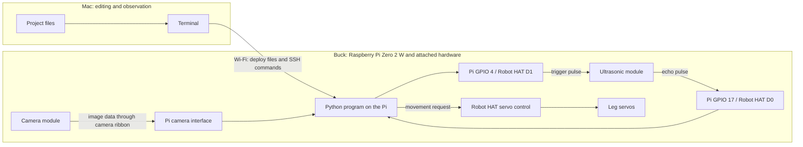
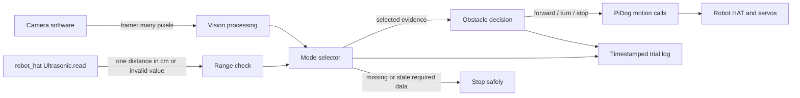

# Buck obstacle course: system diagram

This is our working map of the system. Read it from left to right, then use [system_diagram_notes.md](system_diagram_notes.md) to write your own explanation. We will revise the map when a check on Buck gives us better evidence.

## 1. Where the pieces are

The Mac stores and edits our code. The Python process that needs the camera and ultrasonic sensor runs **on Buck's Pi**. SSH is how the Mac starts that process remotely; it does not make the sensor physically connected to the Mac.

These arrows show **signals and commands**. Power and ground are also necessary, but we will trace Buck's actual power wiring at the robot before adding that path to the diagram.

The trigger and echo arrows point in opposite directions. `Ultrasonic.read()` causes a trigger pulse to go **out** and measures the echo pulse coming **back**. Buck's prior [session log](../session_logs.md) records D1/GPIO 4 as trigger and D0/GPIO 17 as echo. [SunFounder's PiDog FAQ](https://docs.sunfounder.com/projects/pidog/en/latest/faq.html) gives the same GPIO wiring, and its [ultrasonic test](https://github.com/sunfounder/pidog/blob/main/test/ultrasonic_test.py) uses `Ultrasonic(Pin("D1"), Pin("D0"))`.

The camera's ribbon-to-Pi route is documented by [SunFounder's camera troubleshooting guide](https://docs.sunfounder.com/projects/pidog/en/latest/faq.html). The Vilib package is installed on Buck according to our session log; **camera capture itself has not yet been checked in this project**. We will confirm the live camera path before choosing a Python camera API.

## 2. What the software does with the data

The **mode selector** determines which evidence the decision code may use:

| Mode | Evidence allowed for decisions | Evidence excluded from decisions |
| --- | --- | --- |
| Vision only | Camera frame and results derived from it | Ultrasonic distance |
| Ultrasonic only | Ultrasonic distance | Camera frame |
| Combined | Both | None of these two sensors |

The planned `forward`, `turn`, and `stop` decisions are **software choices**, not raw sensor values. The later motion program will translate a choice into PiDog commands. The stop path is a design requirement; it is not implemented by this diagram.

## 3. The important boundaries

| Boundary | Input | Output | What we must check |
| --- | --- | --- | --- |
| Physical world → camera | Light from the course | Image data | Is the obstacle visible under course lighting? |
| Physical world → ultrasonic module | A nearby reflecting surface | Echo timing | Does a measured target produce a plausible distance? |
| Hardware → Python | Camera data or GPIO pulse timing | Frame or centimeter reading | Is the reading fresh and valid? |
| Python sensing → decision | Frame features or distance | `forward`, `turn`, or `stop` | Does the selected mode use only its allowed evidence? |
| Decision → motion | Chosen action | Servo commands | Can Buck stop promptly and predictably? |

One camera frame contains spatial information but does not directly give a reliable centimeter distance. One forward ultrasonic reading gives a distance estimate but does not describe every obstacle to the sides. These limits shape the course and the rules we will write.

## 4. What we know, and what we need to verify

**Recorded or documented:** Buck uses a Raspberry Pi Zero 2 W; our earlier ultrasonic test used D1/D0; `pidog`, `robot_hat`, and `vilib` imported successfully; the sonar returned readings after its connector was reseated.

**Still to verify on Buck:** current camera capture, current SSH address, sonar accuracy at measured distances, usable frame rate, camera angle, and the exact movement behavior for this course. A successful package import is not a camera image or a correct distance measurement.

## 5. Follow this document together

1. Point to each physical component on Buck and trace the arrows in diagram 1.
2. Say what crosses each software boundary in diagram 2: pixels, centimeters, a decision, or a servo command.
3. Fill in the explanations and unknowns in [system_diagram_notes.md](system_diagram_notes.md).
4. Only after the diagram makes sense, run the stationary sensor lessons in [learning_notes.md](learning_notes.md).
